<h1>
  <picture>
    <source media="(prefers-color-scheme: dark)" srcset="docs/brand/bitcue-logo-for-dark.png">
    
  </picture>
</h1>

[](https://github.com/journeyonlabs/bitcue/actions/workflows/tests.yml)
[](https://github.com/journeyonlabs/bitcue/releases)
[](LICENSE)

A screen for the Makera Z1 that shows the running job: the bit cutting now, the
next bit and when it is needed, and the time left. At a tool change, the whole
screen turns the color of the bit to load.

- **Bit changes you can see from across the room.** The color of the bit, the
  container the old one goes back into, and what comes after it.
- **Bit life.** Keep several bits of a kind (A, B, C) and BitCue counts how long
  each one has cut, names the least used one at each stop, and, once you set an
  expected life, fills a gauge from green to red.
- **Phone notifications** when the Z1 stops for a bit, a few minutes before, and
  when a job stops with an alarm or is paused. The same screen on your phone.
- **Start jobs from the touch screen**, with a picture of each job's part and a
  check that the plate on the Z1 is the one the job expects.

It runs on a Raspberry Pi with a 2.8" or 3.5" touch screen or an HDMI monitor. Makera
Studio connects to the Z1 through the Pi.

Unofficial: not made by or affiliated with Makera. Version 0.9 (beta).

[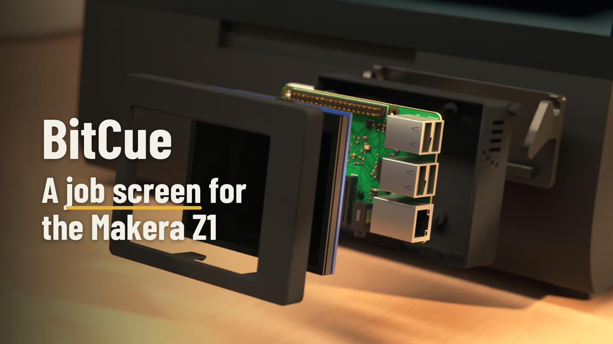](docs/promo.mp4)

Video, 43 s: [docs/promo.mp4](docs/promo.mp4). Rendered from the 3D files, not filmed.

[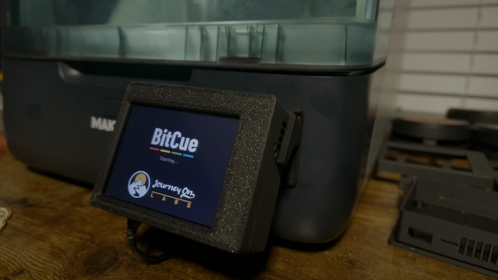](docs/live.mp4)

Video, 37 s: [docs/live.mp4](docs/live.mp4). Filmed on a Makera Z1 during a real job.

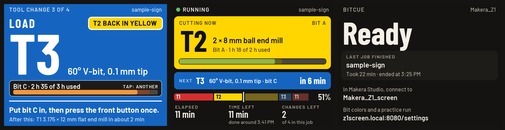

Demo: [play it in your browser](https://journeyonlabs.github.io/bitcue/demo.html), or download
[docs/demo.html](docs/demo.html) and open it. It plays a made-up job on the small screen or the phone page;
you press the Z1's front button.

## Get the hardware

BitCue needs a Raspberry Pi, a touch screen and a housing that hangs on the front of the Z1 or stands on the
desk beside it.
[Get the hardware](docs/buy.md) has both parts:

- **[The 3D files](docs/buy.md#3d-files)** for the housing, from the Printables Store or Cults3D. Print it
  yourself, or have a print service print it for you. They are sold separately and are not in this
  repository.
- **[The electronics](docs/buy.md#electronics-parts-list)**: a parts list for each version (the universal
  one: a Pi 3A+, 3B+ or 4 with the Waveshare 3.5inch DPI screen; or a Pi 4 with the Adafruit PiTFT 2.8").
  BitCue doesn't sell these; some of the links are affiliate links.

## What it does

All pictures below come from the real drawing code, playing made-up sample jobs
(a sign and a tag, cut with four bits).

### At every bit change

The whole screen turns the color of the bit to load. The box next to LOAD says
which container the old bit goes back into, the bar under the bit says which of
your bits of that kind to put in and how worn it is (tap it to use another), and
the bottom line says what comes after this bit.

<p>
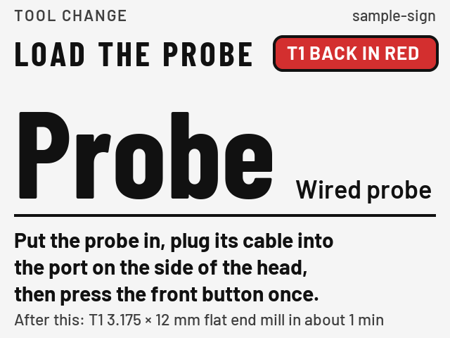
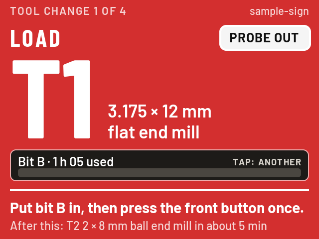
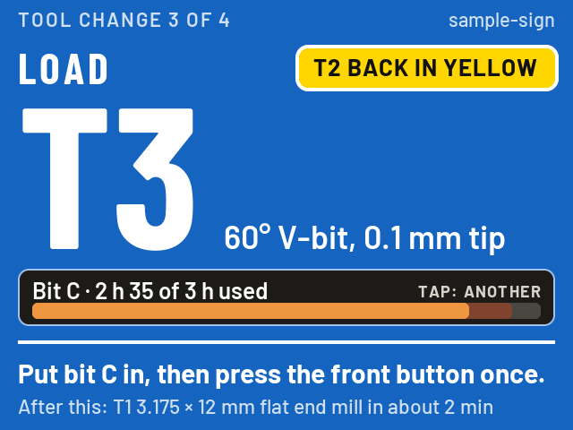
</p>

### While it cuts

The bit cutting now, in its color, with how long that bit has cut; the next
bit and when it is needed; the time left; and a bar of the whole job in bit
colors.

<p>
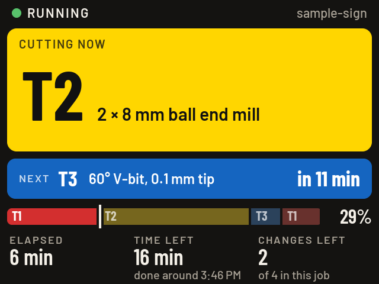
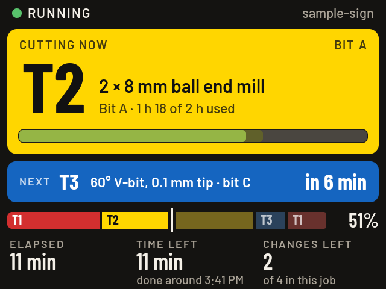
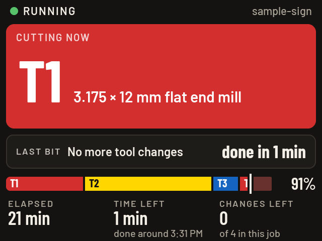
</p>

### Bit life

If you keep several bits of the same kind, label them A, B, C (on the holder
too). BitCue counts how long each one cuts, by the Z1's own job clock, per
material. At each stop it names the least used bit of that kind; tap that line
to use another. Once you set an expected life for a kind of bit on the settings
page, a gauge fills green, then yellow, then red, and a job that would take a
bit past its life is flagged before it starts. Until then it just counts.

### Before and after a job, and when something is wrong

<p>
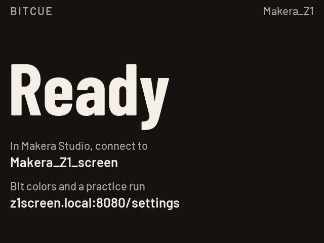
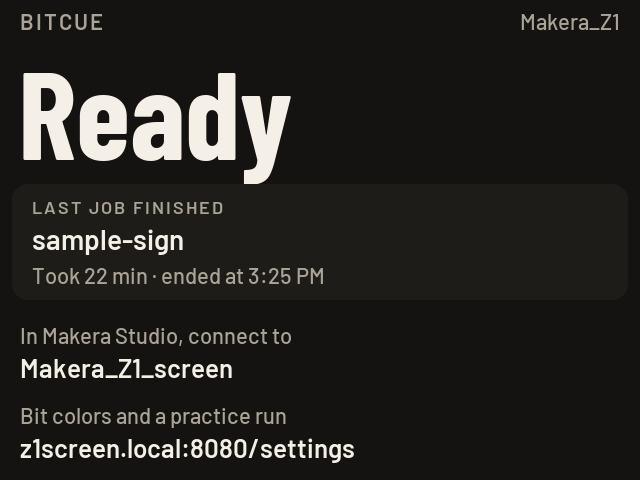
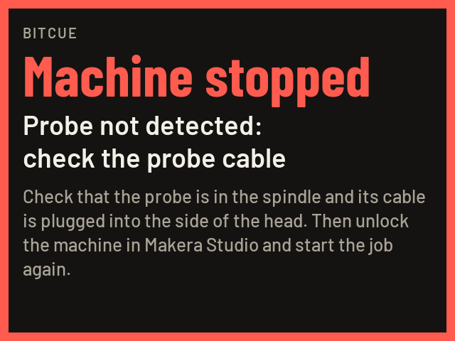
</p>
<p>
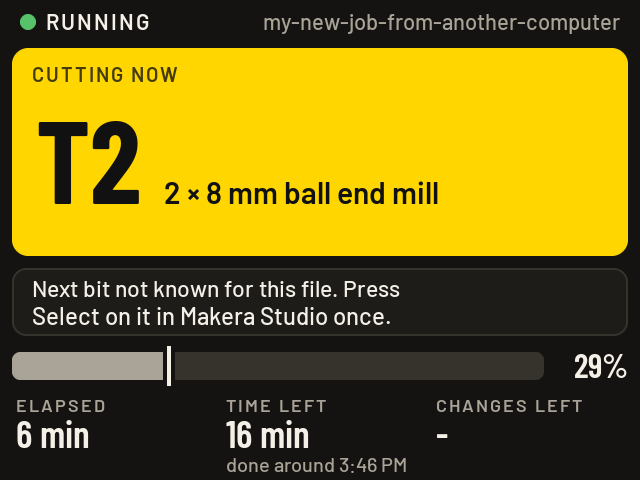
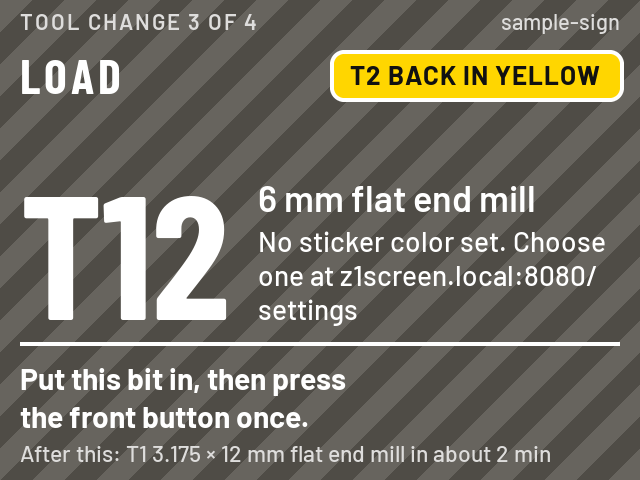
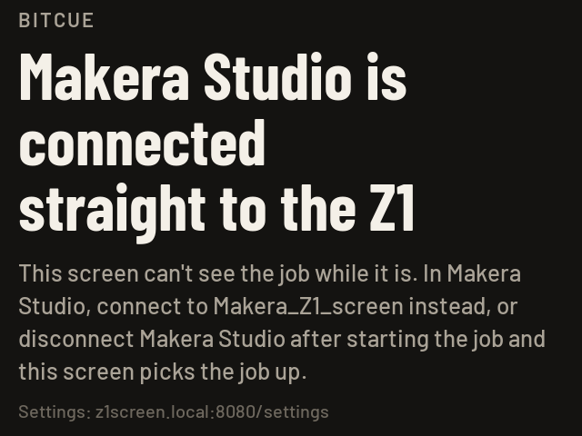
</p>

Every state: [3.5" screen, 640 x 480](docs/screens/dpi35/sheet.png) ·
[2.8" screen, 320 x 240](docs/screens/sheet.png).

### On your phone

The same job screen at `http://z1screen.local:8080`, on any phone or laptop on
the same Wi-Fi.

<p>
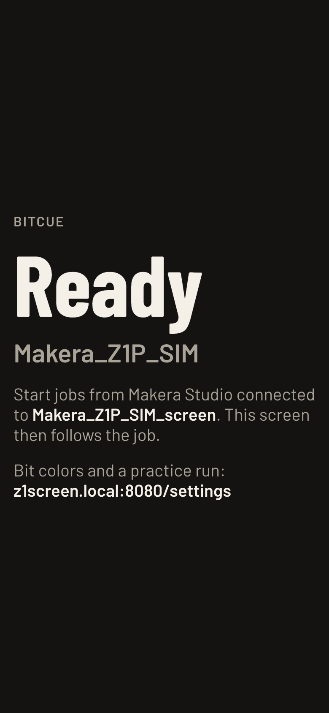
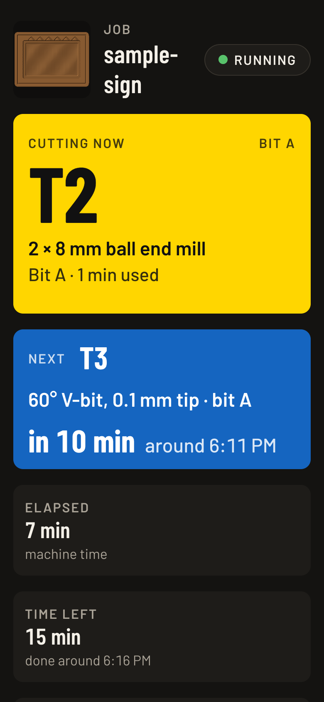
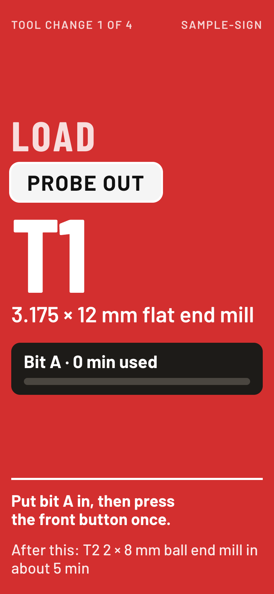
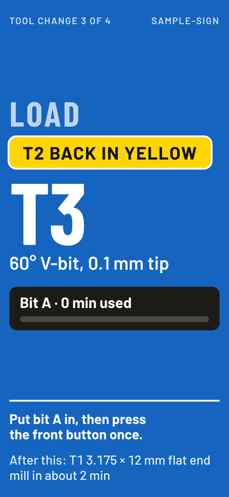
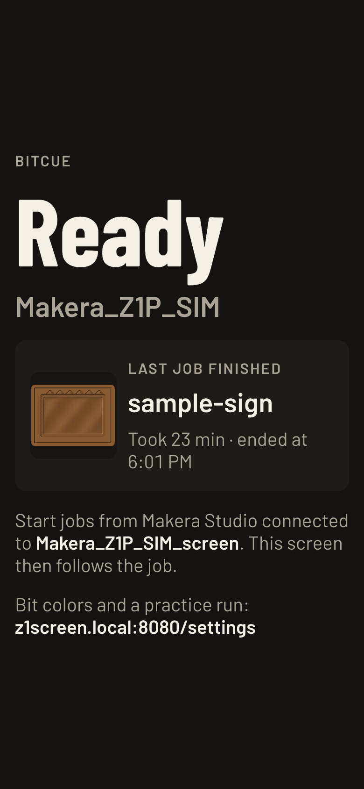
</p>

### Phone notifications

When the Z1 stops, your phone buzzes (through the free ntfy app):

> **Z1 stopped: load T3**<br>
> Blue sticker · 60° V-bit, 0.1 mm tip<br>
> T2 goes back in the Yellow container.<br>
> Change 3 of 4 · sample-sign<br>
> Press the Z1's front button once it's in.

It can also warn a few minutes before a stop ("Z1: T3 in about 3 min"), and tell
you when a job stops with an alarm or is paused:

> **Z1 alarm: job stopped**<br>
> Probe not detected: check the probe cable<br>
> Job: sample-sign

See [Phone notifications](#phone-notifications-optional).

### Starting jobs from the touch screen (optional)

Pick a file on the Z1, place it on the plate clear of what is already cut, check
the plate, then hold START. Each file shows a picture of its part, so it is easy
to see it is the right one: the Pi draws it from the job file (the part seen from
above, in bronze), after it first reads the file. While the Z1 is idle it also
reads again the files it knew before, one at a time, to draw theirs; anything you
do on the screen comes first.

<p>
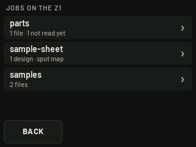
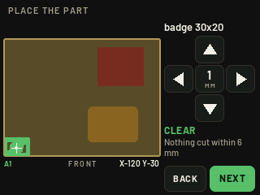
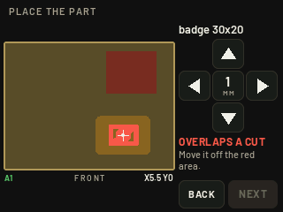
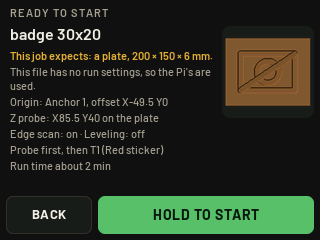
</p>

Every step: [touch screens](docs/screens/touch/sheet.png).

### Settings page

Bit colors, the plate, Anchor 1, notifications and a demo, at
`http://z1screen.local:8080/settings`.

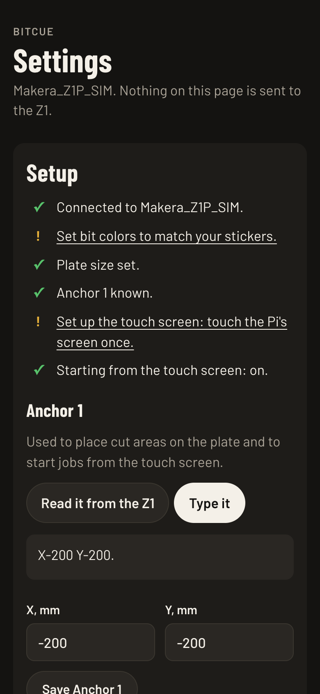

The whole page: [settings-desktop.png](docs/screens/web/settings-desktop.png).

## What you need

The parts list, with links, is in [Get the hardware](docs/buy.md).

One of each:
- A Raspberry Pi 3A+, 3B+, 3B or 4 (pick one) and the Waveshare 3.5inch DPI LCD (640 x 480, capacitive
  touch, SKU 19173)
- The Pi's power supply: 5 V 2.5 A micro-USB for a Pi 3, or 5 V 3 A USB-C for a Pi 4
- microSD card, 16 GB or larger
- A stick-on heatsink for the Pi's processor, 14 x 14 mm
- A housing, printed from [the 3D files](docs/buy.md#3d-files)

For the set-up you choose (or both):
- On the Z1: industrial double-sided tape, 3M VHB 4910 or 5952 (three strips of 1/2 in tape, or two of 3/4
  in), to stick the housing's plate on. The thin tape that comes with the Z1 isn't strong enough: in testing
  it let go within an hour.
- On the desk: four stick-on rubber feet, 8 to 12 mm across, for the table stand

Optional: colored tape or dot stickers, to mark where each bit lives.

Other Pis with Wi-Fi and the 40-pin header (a Zero 2 W, for example), Adafruit's PiTFT Plus 2.8" and an HDMI
monitor work too, but there is no housing for them. More about the screens: [hardware/README.md](hardware/README.md).

## Install

About 20 minutes, most of it waiting. You need the Pi with its screen, the microSD card, a computer with a
card reader, and the name and password of your shop's Wi-Fi (the same network as the Z1).

### 1. Write the card

1. On your computer, install [Raspberry Pi Imager](https://www.raspberrypi.com/software/) and open it.
2. Choose your Raspberry Pi model, then for the operating system **Raspberry Pi OS (other)** >
   **Raspberry Pi OS Lite (64-bit)**, then your microSD card.
3. When Imager offers to customise the settings, say yes and fill in:
   - **Host name:** `z1screen`
   - **User name and password:** pick both yourself. This is the Pi's own password, not a website account.
     Write it down: you type it once during the install, and again only for updates. Nothing shows on the
     screen while you type it.
   - **Wi-Fi:** your shop's network name and password, and your country
   - **Time zone**
   - **SSH:** on, with password login
4. Write the card. Imager erases it.

Forgot the password later? Write the card again and repeat the install; your Z1 is not changed by any of it.

### 2. Start the Pi

Put the screen on the Pi with the power off, put the card in the Pi's slot (on the underside), and plug in the
power. Wait about 2 minutes while it starts the first time and joins the Wi-Fi. The screen may stay blank or
show text until the install has finished.

### 3. Install BitCue

**On a Mac:** download `z1screen-<version>.zip` from the
[latest release](https://github.com/journeyonlabs/bitcue/releases/latest), unzip it and double-click
**Install on the Pi**. If macOS says it can't check the file, open System Settings > Privacy & Security and
click Open Anyway, or run `bash install-to-pi.sh` in Terminal from that folder. It asks:

1. Which screen is on the Pi: press Return for the Waveshare 3.5inch DPI screen (the universal housing),
   or answer 2 for the PiTFT, 3 for an HDMI monitor.
2. Whether the screen hangs in the BitCue housing with the cord out of the bottom: press Return for yes. That
   turns the picture and touches upside down to match ([more](hardware/README.md#mounted-upside-down)).
3. The user name you set in Imager, and the host name (press Return for `z1screen`).
4. The Pi's password.

It copies BitCue to the Pi, installs it (about 5 minutes), restarts the Pi and opens the settings page.

**On Windows, Linux or a Mac without the helper:** open a terminal (PowerShell on Windows) and run
`ssh <user>@z1screen.local` with the user name from Imager. Answer `yes` the first time, type the password,
then run on the Pi:

```
curl -fsSL https://github.com/journeyonlabs/bitcue/releases/latest/download/z1screen.tar.gz | tar xz
sudo bash z1screen/install/install.sh --dpi35 --flip
```

That is for the Waveshare screen in the housing. For the PiTFT leave out `--dpi35`; for a screen that isn't
upside down leave out `--flip`; for a monitor use `--hdmi` alone.

The installer downloads Waveshare's overlay files
([3.5DPI-dtbo.zip](https://files.waveshare.com/wiki/3.5inch%20DPI%20LCD/3.5DPI-dtbo.zip)) and checks them
against the versions it was tested with; it stops if Waveshare has changed them. If the Pi can't reach
Waveshare's site, put that zip next to **Install on the Pi**, or in the `z1screen` folder on the Pi, first.

### 4. Finish

1. Open `http://z1screen.local:8080/settings` on a phone or computer on the same Wi-Fi and follow the Setup
   checklist (your Z1, plate size, Anchor 1, bit colors).
2. In Makera Studio, connect to the machine whose name ends in `_screen`.

To update, repeat step 3 with the new release (in a terminal, first delete the old folder on the Pi with
`rm -rf z1screen`). To remove, run `sudo bash z1screen/install/uninstall.sh` on
the Pi.

## Use

- Start jobs in Makera Studio as usual.
- At each stop, load the bit the screen shows, then press the front button once.
- The box next to LOAD shows which container the old bit goes back into.
- To see the screen on a phone, open `http://z1screen.local:8080`.

## Phone notifications (optional)

Your phone can buzz when the Z1 stops for a bit change, with the bit, its sticker
color and the container the old bit goes back into. It can also warn a few
minutes before the stop, and tell you when a job stops with an alarm (with the
Z1's reason) or is paused. Each stop, alarm or pause sends one notification, and
each kind has its own switch. An alarm with no job running, such as "Machine not
homed" after the Z1 is turned on, sends nothing.

1. Install the free [ntfy](https://ntfy.sh) app (iPhone or Android).
2. On the settings page, under **Phone notifications**, press **New random topic**,
   then **Save**.
3. In the ntfy app, subscribe to that topic. Press **Send a test** to check.

Anyone who knows the topic can read it, so keep the random one. You can also use
your own ntfy server, with an access token if it needs one.

The Pi sends them only for stops it sees: connect Makera Studio through the
`_screen` entry (in polite mode, only while Makera Studio is disconnected). The Pi
needs the internet to reach ntfy.sh; the job itself never depends on it.

To try it:

- **Without the Z1**, on any computer with Python:
  `python3 tools/notify_test.py --topic <your topic> --soon 1` plays a job with
  five bit changes on a pretend Z1, presses the front button by itself after each
  stop, and sends the real notifications (about 2 minutes). Add `--pause` for a
  pause after the first stop and `--alarm` to end with an alarm at the last stop.
- **On the Z1, without cutting**: run [notify-test.nc](notify-test.nc) (five bit
  changes, spindle off, all moves high above the plate, about 7 minutes).

Set the bit colors on the settings page to match your stickers.

## Starting jobs from the touch screen (optional)

This is off by default. Turn it on in Setup. JOBS on the touch screen then
lets you pick a file on the Z1 and place it on the plate. The job starts when
you hold START for 2 seconds.

It only works safely if:

- job files have X0 Y0 at the plate's front left corner, or a run window note
  (below)
- the plate sits in the Anchor 1 corner and its size is set
- Anchor 1 is correct (Setup shows it next to the origin Makera Studio last used)
- you stay at the machine

The Pi refuses to start if the job would overlap an area already cut or run
off the plate, or if the Z1 isn't idle.

## Optional notes in job files

```
; Run window: work origin Anchor 1, offsets 0; Z probe relative to Work Origin at X5 Y5; Scan Margin on; Auto Leveling on, 3 x 3, 2 mm.
; Plywood plate 200 x 150 x 6 mm, pushed into the Anchor 1 corner.
; Part 2 of the 4 that fit on this sheet: center X75 Y30, turned 0°
```

- **Run window:** the settings used when the job starts from the touch screen.
- **Plate:** the plate the file was made for.
- **Part:** marks the file as one spot of a plate layout. Add its folder under
  Plate layout folders in Setup.

## Settings file

Most settings are on the settings page. The rest go in `z1screen.json` on the
SD card's boot drive. For all settings and their defaults, see
[z1screen/config.py](z1screen/config.py).

## Troubleshooting

- **The installer can't find `z1screen.local`.** Give the Pi 2 more minutes, and check that your computer is
  on the same Wi-Fi you set in Imager. Still nothing: write the card again and check the Wi-Fi name and
  password (they are case-sensitive).
- **The password is refused.** It is the one you set in Imager for the Pi, with that user name. If it's lost,
  write the card again with a new one.
- **The screen stays white.** Unplug the Pi for 10 seconds.
- **The screen stays black after power on.** With a small screen the installer hides the Pi's boot messages,
  so BitCue's splash is the first thing it shows. To see the messages, take `quiet` out of `cmdline.txt` on the
  card's boot drive (or plug in an HDMI monitor). The uninstaller puts the file back as it was.
- **"Looking for the Z1".** Check that the Z1 is on the same Wi-Fi, or set
  `machine_ip` in `z1screen.json`.
- **"Connected straight to the Z1".** Reconnect Makera Studio to the `_screen`
  entry.
- **"Next bit not known".** Press Select on the file in Makera Studio.
- **The screen shows but touches do nothing.** Install again with the latest
  kit: it has the touch driver loaded at every boot, which newer Raspberry Pi OS
  kernels no longer do by themselves.
- **Anything else.** Open `http://z1screen.local:8080/debug` and include what it
  shows in your bug report.

## Safety and privacy

- The Pi never stops a job or confirms a tool change.
- It starts a job only when START is held on its own touch screen, with that
  option on.
- Everything stays on your network. To protect the settings page, set a PIN in
  Setup.
- BitCue doesn't change the Z1's firmware. To go back, connect Makera Studio
  straight to the Z1 and peel the housing's plate off; nothing is drilled.
- Use it at your own risk: it is a beta made by one person, not by Makera, and
  you are still responsible for what the Z1 cuts. Stay with the machine when a
  job starts, and don't ask Makera for help with BitCue (see
  [SUPPORT.md](SUPPORT.md)).

## Status

| Feature | Tested on |
|---|---|
| Relay and job screen | A real Z1 Pro |
| Reading folders and files | A simulated Z1 only |
| Reading Anchor 1 from the machine | A simulated Z1 only |
| Starting from the touch screen | A simulated Z1 only |
| Phone notifications | A real Pi and phone, with a simulated Z1 |
| Bit life | A simulated Z1 only |
| Touch after a restart (PiTFT touch driver) | A real Pi 4 with the PiTFT |
| Waveshare 3.5inch DPI screen (`--dpi35`) | A real Pi 3B+ with the screen upside down (`--flip`), on a Z1 |
| Housing, universal version | Printed and fitted with a Pi 3B+ and the Waveshare screen, on a Z1 |
| Table stand | Printed and tested with a Pi 3B+ and the Waveshare screen, November 2026 |

Please report your results with your Z1 model, firmware version and Makera
Studio version.

## Development

```
bash tests/run_all.sh        # all tests (the screen tests need Pillow)
python3 tools/tft_shots.py   # the small-screen pictures in docs/screens (and dpi35/)
python3 tools/touch_shots.py # the touch-screen pictures in docs/screens/touch
python3 tools/web_shots.py   # the phone and settings pictures in docs/screens/web (needs Google Chrome)
python3 tools/notify_test.py # phone notifications on a pretend Z1 (--topic to really send them)
bash tools/make_release.sh   # release files in dist/
```

See [CONTRIBUTING.md](CONTRIBUTING.md). For help, see [SUPPORT.md](SUPPORT.md).

## License

The software in this repository is GPL-3.0-or-later: see [LICENSE](LICENSE). There is no warranty.

The housing's 3D files (STL, 3MF, STEP) are not in this repository and are not covered by the GPL. They are
sold separately under the store's personal-use licence ([Get the hardware](docs/buy.md#3d-files)).

Third-party credits are in [NOTICE.md](NOTICE.md).

Makera and Makera Z1 are trademarks of Makera Inc. This project is not
affiliated with Makera.
