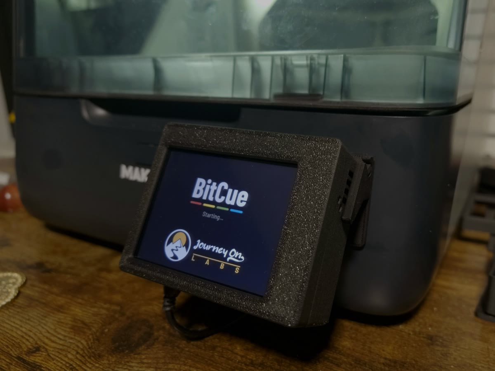
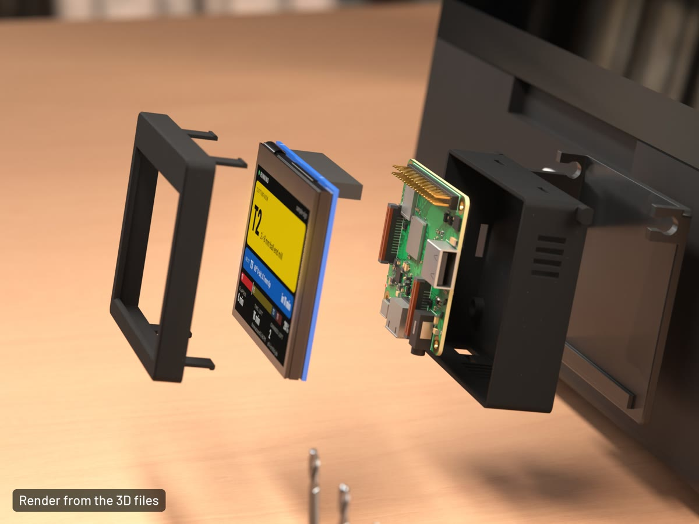
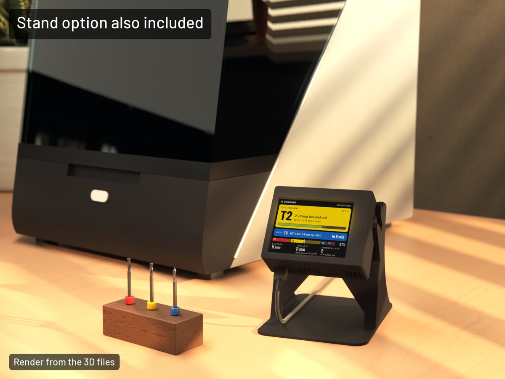
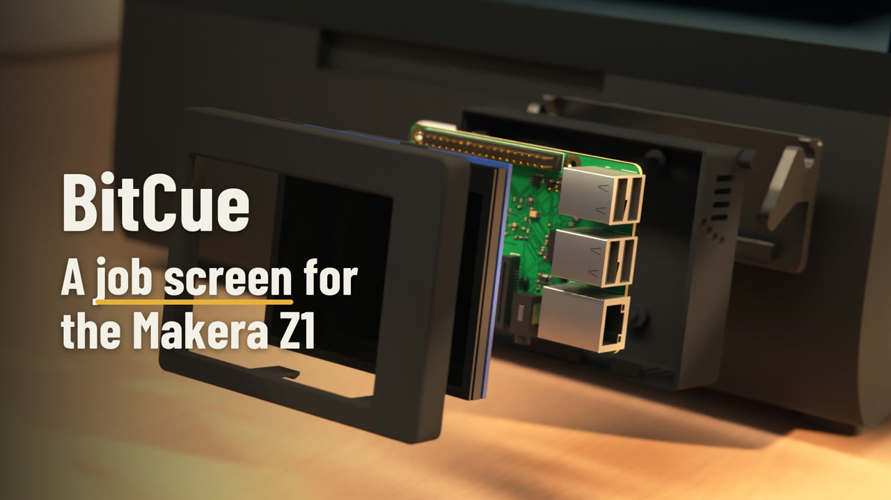
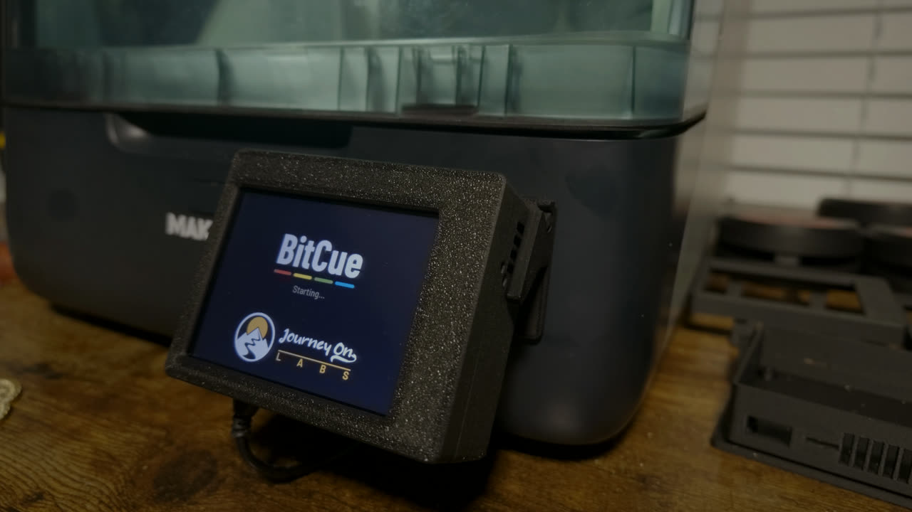
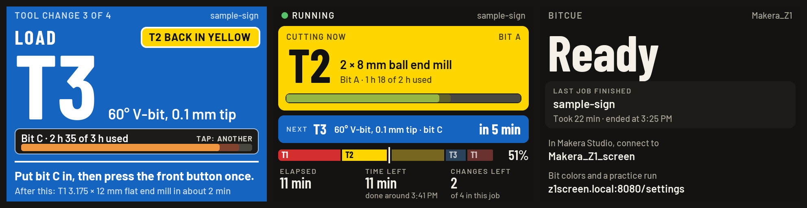

<h1></h1>

A screen for the Makera Z1 that shows the running job: the bit cutting now, the next bit and when it is
needed, and the time left. At a tool change, the whole screen turns the color of the bit to load.

**The housing** hangs on the Z1's front base (VHB tape, no drilling) or stands on the desk beside it, and
prints without supports. Its 3D files are $8 on the
[Printables Store](https://www.printables.com/model/1909246-bitcue-screen-housing-for-makera-z1-raspberry-pi-t)
or [Cults3D](https://cults3d.com/en/3d-model/gadget/bitcue-screen-housing-for-makera-z1-raspberry-pi-touch-screen-snap-fit-z1-mou):
print it yourself or have it printed. The software is free. Left: a photo on a real Z1; middle and right:
renders from the 3D files.

Film, 50 s, on YouTube. Rendered from the 3D files, not filmed.

Video, 37 s, on YouTube. Filmed on a Makera Z1 during a real job.

- **[Try the demo](demo.html)** in your browser: a made-up job on the small screen or the phone page; you
  press the Z1's front button.
- **[Get the hardware](buy.md):** the housing's 3D files, and a parts list for the Raspberry Pi, the touch
  screen and the rest.
- **[Install it](https://github.com/journeyonlabs/bitcue#install):** BitCue is free, open-source software
  (GPL-3.0-or-later). The code, the install steps and help are on
  [GitHub](https://github.com/journeyonlabs/bitcue).

Unofficial: not made by or affiliated with Makera. Makera and Makera Z1 are trademarks of Makera Inc.
